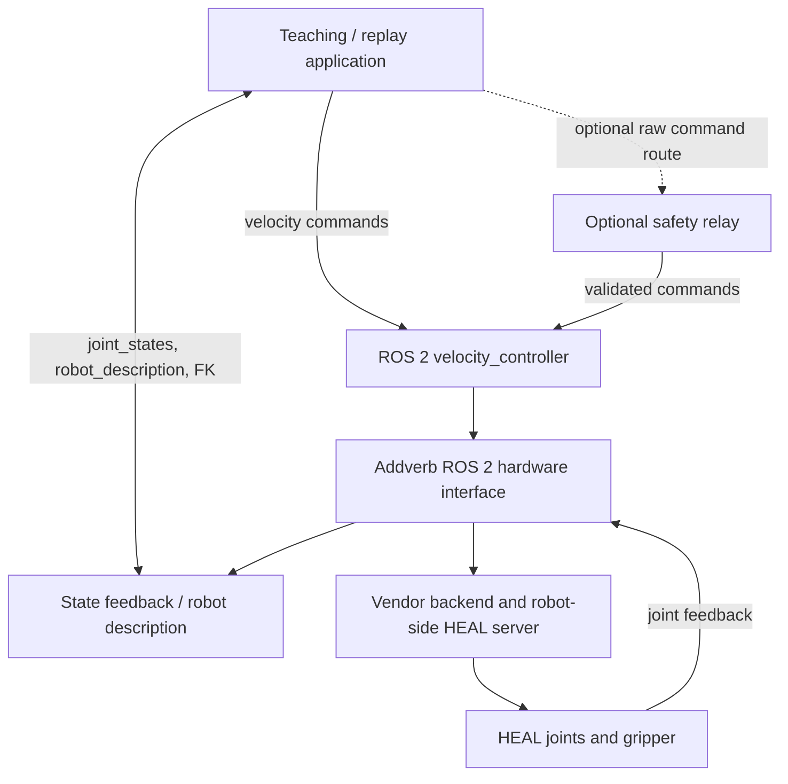

# HEAL system architecture (static source reconstruction)

This describes **source-level relationships** from the recovered lab export, not a verified deployed build. Vendor binaries, the robot-side server and the complete active runtime were not available for execution or inspection.

## Layers

**Application layer:** `starter/heal/Dual_Arm/homing_codes/heal_going_home.py`, `sample_ik/heal_dls_ik.py`, `utils/dls_velocity_commander.py`, `utils/quintic_planner.py`, and `heal_end_effector_pub_node.py` demonstrate joint and Cartesian operations.

**ROS control layer:** Prior lab workspace includes `addverb_cobot_control/launch/velocity_control.launch.py`, controller implementations, hardware interface, joint-state broadcaster, and custom messages.

**Vendor backend:** The lab archive references a local backend directory (headers and previously compiled shared libraries). The current starter README indicates a newer robot-side deployment and `heal_server` executable. Exact vendor API behavior and deployment compatibility are unverified.

**Free-drive/recording:** Source contains `FreeDriveController` and `RecorderController`, but the manual-guidance startup procedure needs an approved hardware-side review. Recorded timing in the source implementation has a suspected sub-second sampling issue; a dedicated timestamped logger is recommended.

## Key integration risks

- Multiple copies of the ROS 2 workspace differ at velocity handling and commissioning controls.
- Launching the hardware interface can trigger robot power-on via its activation path.
- The vendor backend's compiled libraries, controller server and any hardware watchdog are not verified by the ZIP.
- Auxiliary research code mixes ROS 1/ROS 2 generations. The wire-trace project should use explicitly ROS 2-compatible components.

See `docs/control-interfaces.md` and `docs/safety-and-open-questions.md` before considering hardware use.
